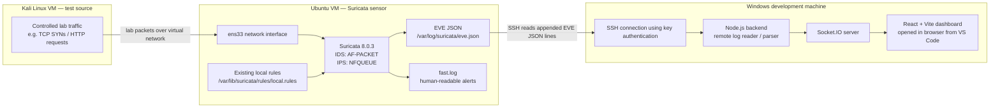

# Suricata SOC Monitor — Real-Time IDS/IPS Threat Telemetry Dashboard

[](https://suricata.io/)
[](https://socket.io/)
[](https://nodejs.org/)
[](https://expressjs.com/)
[](https://react.dev/)
[](https://tailwindcss.com/)

A real-time SOC-style dashboard for monitoring network security events generated by **Suricata on an Ubuntu VM**. Kali Linux generates controlled traffic in an isolated lab. A Node.js backend running on the Windows development machine connects to Ubuntu over SSH, reads Suricata's EVE JSON log, normalizes the events, and streams them to a React web interface through Socket.IO. The dashboard is developed and viewed locally in VS Code/browser.

> **This project does not use MongoDB.** Do not configure `MONGODB_URI` or describe the project as MongoDB-backed unless the implementation is changed. The data path documented here is SSH log access → Node.js backend → Socket.IO → React dashboard. Any history/persistence is limited to what the current application code actually implements.

## 1. Project architecture



### End-to-end event flow

1. Kali generates traffic to the Ubuntu lab VM.
2. Suricata observes traffic on Ubuntu's `ens33` interface. In IDS mode it passively detects matching traffic; in the configured IPS mode, matching traffic that traverses the NFQUEUE path can be dropped or rejected according to rule action.
3. Suricata writes JSON event records to `/var/log/suricata/eve.json` and readable alerts to `/var/log/suricata/fast.log`.
4. The Node.js backend on Windows authenticates to Ubuntu over SSH using the configured private key and reads the remote EVE log.
5. The backend parses/normalizes incoming JSON records and emits events through Socket.IO.
6. The React dashboard receives the events and updates the live alert feed, summaries, charts, and event details without a manual page refresh.

SSH is the remote-access/log-reading channel. Socket.IO is the local backend-to-browser real-time channel. They serve different purposes.

## 2. Key features

- **Live alert feed:** displays new Suricata alert events as they arrive.
- **Remote log ingestion over SSH:** reads the EVE JSON file from Ubuntu without copying the log manually.
- **Real-time browser updates:** Socket.IO streams backend events to the React dashboard.
- **IDS/IPS demonstration:** supports a passive AF-PACKET detection workflow and the normal NFQUEUE IPS service workflow.
- **Alert context:** presents signature name/SID, timestamp, protocol, source/destination addresses and ports, and the action classification available from the event.
- **Threat summaries and visualizations:** shows alert trends, frequently triggered signatures, and talkers where supported by the current UI.
- **EVE JSON visibility:** allows investigation of the underlying Suricata event data where exposed by the dashboard.
- **Lab-based repeatable testing:** includes controlled test scenarios using Kali and the existing rules.
- **No database dependency in the documented setup:** MongoDB is not required for the SSH → backend → Socket.IO pipeline described here.

**Action semantics matter:** an `alert` rule reports a match; it does not by itself block traffic. A `drop` or `reject` rule can enforce prevention only when Suricata is running in a working inline IPS path and the tested traffic traverses the configured NFQUEUE rules. A dashboard label is not proof that a packet was blocked; corroborate with EVE events, firewall/queue configuration, and the client request result.

## 3. Technology stack

| Layer | Technology / configuration |
|---|---|
| Detection and prevention | Suricata 8.0.3 on Ubuntu |
| IDS capture mode | AF-PACKET on `ens33` using `/etc/suricata/suricata.yaml.pre-nfq-ips` after validation |
| IPS capture/enforcement | NFQUEUE queue `0`, started by the normal `suricata` systemd service |
| Test traffic source | Kali Linux VM |
| Remote access and log reading | OpenSSH with key-based authentication |
| Backend | Node.js, Express, Socket.IO; inspect `package.json` for exact installed versions |
| Frontend | React, Vite, Tailwind CSS and the chart/icon packages present in `package.json` |
| Live transport | Socket.IO from backend to browser |
| Log source | `/var/log/suricata/eve.json` on Ubuntu |
| Development environment | Windows, VS Code, browser |
| Database | **No MongoDB in the described setup** |

The README intentionally avoids claiming exact library versions beyond those already identified for the project. `package.json` and the lockfile are the source of truth for installed package versions.

## 4. Repository setup — Windows / VS Code

### Prerequisites

- Windows with OpenSSH Client available in PowerShell.
- Node.js 20.x (use the version supported by this repository's `package.json`).
- Git and VS Code.
- Ubuntu VM running Suricata and reachable over the lab network.
- Kali VM on the same virtual network for authorized tests.
- SSH key authentication from Windows to the Ubuntu account that can read Suricata logs.

### Clone and install

Open PowerShell in VS Code or Windows Terminal:

```powershell
git clone https://github.com/siddhanth4/Suricata-Monitoring-Dashboard.git
cd Suricata-Monitoring-Dashboard
npm install
Copy-Item .env.example .env
```

If `.env.example` is not present in the repository, create `.env` in the project root and add the variables below. Do not commit `.env` or a private key.

### Configure `.env`

```dotenv
SURICATA_SSH_HOST=192.168.194.132
SURICATA_SSH_USER=YOUR_UBUNTU_USERNAME
SURICATA_SSH_KEY_PATH=C:/Users/YOUR_WINDOWS_USERNAME/.ssh/suricata_dashboard
SURICATA_EVE_PATH=/var/log/suricata/eve.json
DEMO_MODE=false
```

Replace the example host/user/path with your actual values. Use forward slashes in Windows paths to avoid `.env` backslash parsing problems. `SURICATA_EVE_PATH` is the **remote Ubuntu path**, not a Windows path. `DEMO_MODE=false` is for live ingestion; use the project's documented demo-mode behavior only if intentionally testing without live Suricata data. Do not add quotes unless the application's environment parser expects them.

### Start the dashboard

Check the scripts in `package.json`, then run the repository's development command. For this project, if the script is defined as shown in the codebase:

```powershell
npm run dev
```

Open the local URL printed by Vite/Express in the terminal. The dashboard is viewed in your Windows browser; VS Code is the development environment, not the log source.

## 5. Create and configure SSH key authentication

The backend uses SSH to read a file on Ubuntu. It should not need to run Node.js as Windows Administrator or Ubuntu root.

### A. Generate a dedicated key on Windows

In PowerShell:

```powershell
New-Item -ItemType Directory -Force "$env:USERPROFILE\.ssh" | Out-Null
ssh-keygen -t ed25519 -f "$env:USERPROFILE\.ssh\suricata_dashboard" -C "suricata-dashboard-readonly"
```

Set a passphrase if the backend's SSH implementation supports loading it non-interactively through an SSH agent. If it does not, follow the repository's SSH library requirements; do not put the passphrase in `.env`.

This creates:
- Private key: `%USERPROFILE%\.ssh\suricata_dashboard` — keep secret.
- Public key: `%USERPROFILE%\.ssh\suricata_dashboard.pub` — safe to copy to Ubuntu.

### B. Install the public key on Ubuntu

From PowerShell, replace `YOUR_UBUNTU_USERNAME` and the IP if needed:

```powershell
Get-Content "$env:USERPROFILE\.ssh\suricata_dashboard.pub" |
  ssh YOUR_UBUNTU_USERNAME@192.168.194.132 "umask 077; mkdir -p ~/.ssh; cat >> ~/.ssh/authorized_keys; chmod 700 ~/.ssh; chmod 600 ~/.ssh/authorized_keys"
```

If password SSH login is disabled, use an existing authorized administration method to place the `.pub` key into the Ubuntu account's `~/.ssh/authorized_keys`. Never copy the private key to Ubuntu.

### C. Test the SSH connection

```powershell
ssh -i "$env:USERPROFILE\.ssh\suricata_dashboard" YOUR_UBUNTU_USERNAME@192.168.194.132
```

If prompted about the host fingerprint, verify it through a trusted method before accepting it. After login, exit with `exit`.

### D. Verify that the SSH account can read the EVE file

On Ubuntu:

```bash
ls -l /var/log/suricata/eve.json
namei -l /var/log/suricata/eve.json
```

Then, from PowerShell, test remote reading:

```powershell
ssh -i "$env:USERPROFILE\.ssh\suricata_dashboard" YOUR_UBUNTU_USERNAME@192.168.194.132 "tail -n 2 /var/log/suricata/eve.json"
```

If permission is denied, prefer a narrow, audited read-only access design for the log file/directory or a dedicated log-reader account. Do **not** make all log files world-readable with broad `chmod 644` changes as a shortcut, and do not give the dashboard SSH user unrestricted root access. If using a group-based solution, ensure the account has directory traversal and file read permissions and log out/in after group changes.

### E. Configure the key path

In `.env`, use the absolute path to the private key (no `.pub` suffix):

```dotenv
SURICATA_SSH_KEY_PATH=C:/Users/YOUR_WINDOWS_USERNAME/.ssh/suricata_dashboard
```

Restart the Node process after editing `.env`. Do not print or paste private-key contents into logs, screenshots, GitHub, or chat.

## 6. Ubuntu verification commands

Run these on Ubuntu:

```bash
ip -brief address show
suricata --build-info
sudo systemctl status suricata --no-pager -l
ps -eo pid,args | grep '[s]uricata'
sudo tail -n 10 /var/log/suricata/eve.json
sudo tail -n 20 /var/log/suricata/fast.log
```

Known lab addressing from the documented setup (verify each time):
- Ubuntu: `192.168.194.132`, interface `ens33`.
- Kali: `192.168.194.129`, interface `eth0`.

### Check the SSH-to-dashboard pipeline

1. Confirm SSH works from PowerShell.
2. Confirm the remote EVE file contains new JSON records.
3. Start the backend from the project root and check its terminal for SSH, parsing, or connection errors.
4. Open the dashboard URL and generate one controlled test event.
5. Confirm that the same event's timestamp, SID, source and destination are reflected in the UI.

## 7. IDS vs IPS live demo workflow

> Validate the candidate configuration and confirm the existing rules before the interview. The file name `suricata.yaml.pre-nfq-ips` is only a name; the actual command-line mode, configuration, rules and network path determine behavior. Do not edit or add rules as part of the demo unless intentionally changing the lab.

### A. IDS — AF-PACKET (passive detection)

First validate the candidate configuration:

```bash
sudo suricata -T -c /etc/suricata/suricata.yaml.pre-nfq-ips
sudo sed -n '650,710p' /etc/suricata/suricata.yaml.pre-nfq-ips
sudo sed -n '2295,2330p' /etc/suricata/suricata.yaml.pre-nfq-ips
```

Confirm the AF-PACKET interface is `ens33` and the rule path includes the intended existing rules. Then stop the systemd IPS service:

```bash
sudo systemctl stop suricata
sudo systemctl status suricata --no-pager
sudo iptables -vnL INPUT
sudo iptables -vnL OUTPUT
```

Confirm the service is stopped and its helper has removed the scoped NFQUEUE rules. Do not run a second Suricata process while the service is still active.

Start the IDS process in the foreground:

```bash
sudo suricata --af-packet -c /etc/suricata/suricata.yaml.pre-nfq-ips
```

Keep this terminal open. Generate the relevant test traffic from Kali. Monitor `fast.log`, `eve.json`, and the dashboard. Stop the foreground process with `Ctrl+C` when finished.

Expected: matching `alert` rules are reported. Passive IDS mode does not enforce the configured `drop`/`reject` actions as an inline firewall.

### B. IPS — NFQUEUE (inline enforcement)

After stopping the foreground IDS process with `Ctrl+C`:

```bash
sudo systemctl start suricata
sudo systemctl status suricata --no-pager -l
ps -eo pid,args | grep '[s]uricata'
sudo iptables -vnL INPUT
sudo iptables -vnL OUTPUT
```

Confirm the running command uses `/etc/suricata/suricata.yaml` and `-q 0`, and confirm the expected narrow NFQUEUE rules are present. In this lab, the queue rules are scoped to Kali `192.168.194.129` ↔ Ubuntu `192.168.194.132` TCP port `8080`; other ports/protocols are not necessarily queued.

Use the existing HTTP IPS rules and test server on Ubuntu port `8080`:

```bash
# Ubuntu — keep this running in a separate terminal if the test server is not already running
python3 -m http.server 8080 --bind 192.168.194.132 --directory ~/suricata-ips-lab/empty
```

From Kali, run the already-tested requests:

```bash
curl --max-time 5 -X POST --data-binary 'system("test")' http://192.168.194.132:8080/
curl --max-time 5 'http://192.168.194.132:8080/?q=OR%201=1'
```

Check the alert SID and verdict in EVE JSON. A timeout alone is not proof of blocking. Verify the matching event, `verdict.action` when present, NFQUEUE rules/counters, and the request outcome. When done, leave the normal systemd IPS service running if that is your intended default.

## 8. Important commands cheat sheet

```bash
# Ubuntu: interface and IP
ip -brief address show
hostname -I

# Validate a configuration
sudo suricata -T -c /etc/suricata/suricata.yaml.pre-nfq-ips
sudo suricata -T -c /etc/suricata/suricata.yaml

# Check service and processes
sudo systemctl status suricata --no-pager -l
sudo systemctl stop suricata
sudo systemctl start suricata
ps -eo pid,args | grep '[s]uricata'

# Inspect NFQUEUE firewall rules/counters
sudo iptables -vnL INPUT
sudo iptables -vnL OUTPUT

# Follow human-readable alerts
sudo tail -f /var/log/suricata/fast.log

# Follow EVE JSON
sudo tail -f /var/log/suricata/eve.json

# Filter SID 1000007 (FTP-port SYN threshold heuristic)
sudo grep '1000007' /var/log/suricata/fast.log
sudo jq -c 'select(.event_type=="alert" and .alert.signature_id==1000007)' /var/log/suricata/eve.json

# Windows PowerShell: SSH read test
ssh -i "$env:USERPROFILE\.ssh\suricata_dashboard" YOUR_UBUNTU_USERNAME@192.168.194.132 "tail -n 2 /var/log/suricata/eve.json"
```

## 9. Troubleshooting

- **Dashboard shows no live events:** confirm `DEMO_MODE=false`, SSH host/user/key path, remote EVE path, SSH login, read permissions, backend terminal errors, and that Suricata is generating events.
- **SSH works manually but backend fails:** confirm the SSH library used by the app accepts the configured key format and path. Restart the backend after `.env` changes.
- **No SID 1000007 alert:** confirm the IDS is capturing on `ens33`, the loaded rules include SID `1000007`, `$HOME_NET` includes `192.168.194.132`, and at least 10 matching SYN packets reach TCP/21 within 60 seconds. A single port scan may not meet the threshold.
- **Duplicate-looking dashboard alerts:** compare raw events in `eve.json` and `fast.log` with dashboard rows. If raw files contain two events, Suricata may have emitted two legitimate alert events; if the raw file contains one but the UI shows two, inspect log ingestion/reconnection/deduplication. Do not suppress all repeated events based only on matching SID and endpoints.
- **IPS request still succeeds:** verify the service uses `-q 0`, the scoped NFQUEUE rule counters increase, the test traffic matches the queued source/destination/port, the matching rule is loaded, and the rule action is `drop` or `reject`. An `alert` action alone does not block.
- **Config test fails:** do not switch modes until `suricata -T` succeeds. Keep the current known-good config backed up.

## 10. Documentation index

- [System Architecture](https://github.com/siddhanth4/Suricata-Monitoring-Dashboard/blob/main/docs/architecture.md)
- [Ubuntu VM Setup Guide](https://github.com/siddhanth4/Suricata-Monitoring-Dashboard/blob/main/docs/ubuntu-setup.md)
- [IDS/IPS Rules & Testing Guide](docs/ids-ips-rules-testing.md)
- [REST API & Socket.IO Reference](https://github.com/siddhanth4/Suricata-Monitoring-Dashboard/blob/main/docs/api-reference.md)
- [Troubleshooting Guide](https://github.com/siddhanth4/Suricata-Monitoring-Dashboard/blob/main/docs/troubleshooting.md)
- [Security Considerations](https://github.com/siddhanth4/Suricata-Monitoring-Dashboard/blob/main/docs/security.md)

## 11. Scope and safety

This is an educational defensive lab. Generate test traffic only between systems you own or have explicit permission to assess. Rule matches are indicators, not proof that an exploit succeeded or a login was compromised.
