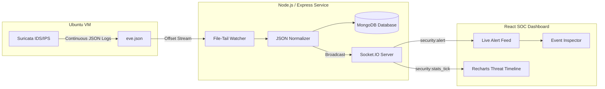

# Suricata SOC Monitor: Real-Time Hybrid IDS/IPS Threat Telemetry Dashboard

[](https://nodejs.org/)
[](https://expressjs.com/)
[](https://react.dev/)
[](https://tailwindcss.com/)
[](https://socket.io/)
[](https://www.mongodb.com/)
[](https://suricata.io/)

A cybersecurity Security Operations Center (SOC) web application built with the MERN stack to ingest, analyze, index, and visualize real-time network intrusion detection events from **Suricata IDS/IPS** running on an Ubuntu virtual machine.

---

## 1. Problem Statement & Architecture

Network Intrusion Detection Systems (NIDS) like Suricata produce high-velocity telemetry in `eve.json` log files. Without modern real-time visual streaming, security analysts struggle to distinguish critical active exploits from background reconnaissance, or to verify whether an alert was merely reported in passive IDS mode or actively blocked inline by IPS rules.

**Suricata SOC Monitor** establishes a streaming telemetry pipeline from raw host packet capture down to an interactive, high-contrast dark SOC dashboard.



---

## 2. Key Features

- **Live Streaming Alert Feed**: Alerts append instantly at the top of the feed via WebSocket with visual flash highlights and zero page reload.
- **Accurate IDS vs IPS Action Semantics**: Distinguishes between detection alerts (`ALERT`), confirmed inline drops (`DROP`), TCP resets (`REJECT`), allowed flows (`PASS`), and unverified telemetry (`UNKNOWN`).
- **Dynamic Threat Timeline**: Visualizes incident spikes and severity classifications across user-selected windows (`15m`, `1h`, `24h`, `7d`, `all`).
- **Top Talkers & Signatures**: Aggregates network endpoints and most frequently triggered Emerging Threats (ET) signatures.
- **Full EVE Telemetry Inspector**: Explores DNS queries, HTTP user-agents, TLS SNI headers, and Flow summaries with raw JSON payload inspection and copy-to-clipboard.
- **Formula-Sanitized CSV Export**: Exports filtered alerts while neutralizing spreadsheet formula injection attacks (`=`, `+`, `-`, `@`).
- **Built-in Lab Traffic Simulation**: Pre-configured Kali Linux attack scenarios (Log4j RCE, Nmap SYN scans, SQL injection, SSH brute force, and EternalBlue SMB drops) for testing without live Suricata traffic.
- **Resilient Dual Storage Engine**: Connects to MongoDB via Mongoose when available, with automatic fallback to an in-memory document store so the application runs seamlessly out of the box in any development or cloud environment.

---

## 3. Technology Stack

- **Frontend**: React 19, Vite, Tailwind CSS v4, Recharts, Lucide Icons, Socket.IO Client.
- **Backend**: Node.js, Express, Socket.IO, Mongoose, Helmet, CORS.
- **Engine**: Suricata 7.x running on Ubuntu Linux (monitoring `ens33` / `eth0`).
- **Testing**: Native automated test suite covering JSON parsing, null-safety, deduplication, and persistence.

---

## 4. Quick Start & Execution

### Prerequisites
- Node.js v18+ or v20+
- (Optional) MongoDB running at `mongodb://127.0.0.1:27017`

### Installation
```bash
# Clone the repository
git clone https://github.com/your-username/suricata-soc-monitor.git
cd suricata-soc-monitor

# Install dependencies
npm install

# Configure environment
cp .env.example .env
```

### Running the Application
```bash
# Start full-stack server (runs backend and Vite on http://localhost:3000)
npm run dev
```

Visit **http://localhost:3000** to access the SOC Command Center.

### Running Automated Tests
```bash
npx tsx server/tests/suricata.test.ts
```

---

## 5. Connecting Live Suricata on Ubuntu VM

1. **Verify Network Interface**:
   ```bash
   ip -brief address show
   ```
2. **Enable EVE JSON** in `/etc/suricata/suricata.yaml`:
   ```yaml
   outputs:
     - eve-log:
         enabled: yes
         filetype: regular
         filename: eve.json
         types: [alert, flow, http, dns, tls, ssh, stats]
   ```
3. **Grant Read Access** (Never run Node as root):
   ```bash
   sudo chmod 755 /var/log/suricata
   sudo chmod 644 /var/log/suricata/eve.json
   ```
4. **Start Suricata**:
   ```bash
   sudo suricata -c /etc/suricata/suricata.yaml -i <YOUR_INTERFACE> -D
   ```

Refer to [`docs/ubuntu-setup.md`](docs/ubuntu-setup.md) for full deployment instructions.

---

## 6. Authorized Kali Linux Testing Workflow

From your Kali Linux virtual machine targeting your Ubuntu lab VM:

```bash
# 1. Nmap Stealth SYN Scan
nmap -sS -sV -p 80,443,22 <TARGET_UBUNTU_IP>

# 2. Log4j Exploit Probe (CVE-2021-44228)
curl -A '${jndi:ldap://127.0.0.1:1389/Exploit}' http://<TARGET_UBUNTU_IP>/

# 3. SQL Injection Probe
curl 'http://<TARGET_UBUNTU_IP>/products?id=1%20UNION%20SELECT%201,2,3--'
```

Watch newly detected alerts immediately appear in the **Live Security Alert Stream** without refreshing your browser.

---

## 7. Documentation Index

- [System Architecture](docs/architecture.md)
- [Ubuntu VM Setup Guide](docs/ubuntu-setup.md)
- [REST API & Socket.IO Reference](docs/api-reference.md)
- [Troubleshooting Guide](docs/troubleshooting.md)
- [Security Considerations](docs/security.md)

---

## 8. License & Portfolio Attribution

Designed and engineered as a cybersecurity monitoring portfolio demonstration. Free for educational and authorized defensive security research.
