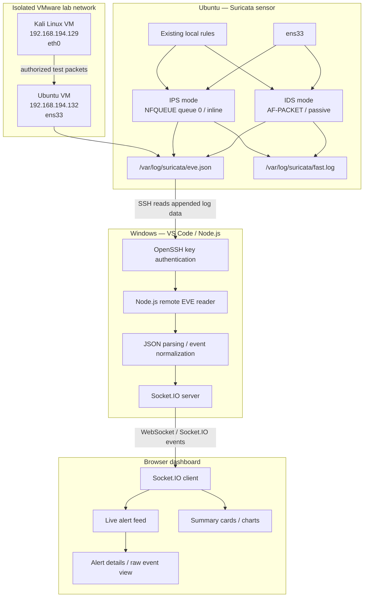
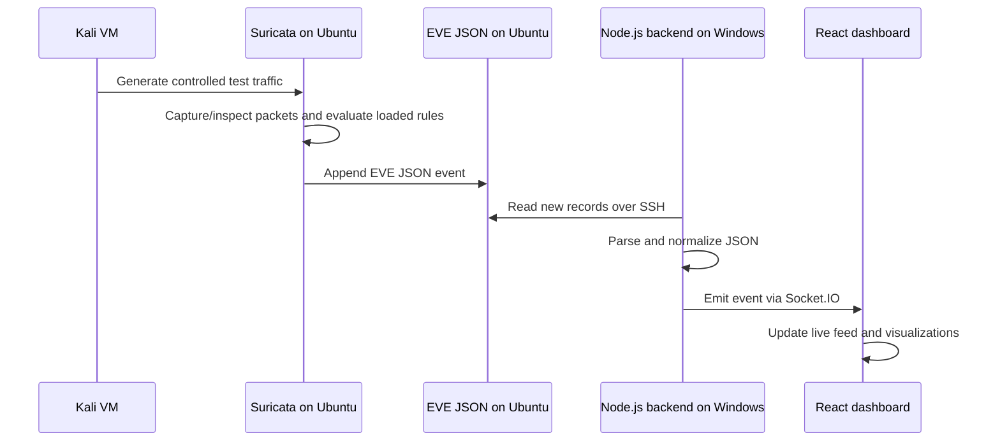

# Suricata SOC Monitor — Architecture & Data Flow

## 1. Purpose

Suricata SOC Monitor presents live network-security telemetry from Suricata running on an Ubuntu VM. Kali Linux is the controlled traffic source. The dashboard backend runs on Windows during development, accesses Ubuntu's EVE log through SSH, and pushes parsed events to the React frontend through Socket.IO.

**Storage note:** the documented implementation does not use MongoDB. Do not describe it as a MongoDB-backed MERN application. Check the actual source code before claiming persistent event storage or historical database queries.

## 2. High-level architecture



The diagram is conceptual: IDS and IPS are alternative operating modes for the sensor, not two independent Suricata engines that must run simultaneously. The frontend components shown are features only where present in the current repository.

## 3. The two data channels

### SSH: Ubuntu → Windows backend

- **Purpose:** secure remote access to the EVE JSON file.
- **Authentication:** a private key remains on Windows; its corresponding public key is installed in the Ubuntu account's `~/.ssh/authorized_keys`.
- **Remote source:** `/var/log/suricata/eve.json`.
- **Configuration:** `SURICATA_SSH_HOST`, `SURICATA_SSH_USER`, `SURICATA_SSH_KEY_PATH`, and `SURICATA_EVE_PATH`.
- **Security:** use a dedicated account with the minimum read permissions needed. Do not store private-key material in Git or give the application unrestricted root access.

### Socket.IO: backend → browser

- **Purpose:** push parsed events from the backend to the dashboard with low latency.
- The browser does not SSH directly to Ubuntu.
- The backend is responsible for SSH access, reading and parsing the log, and emitting application events.
- The exact Socket.IO event names and REST endpoints must be verified against the current source code and are documented in `api-reference.md` only after being checked.

## 4. Suricata IDS and IPS modes

### IDS — AF-PACKET

AF-PACKET captures packets from the configured Linux network interface (`ens33` in this lab) and evaluates them against loaded rules. It is used here as a passive monitoring/detection mode. A rule with action `alert` writes telemetry; `drop` and `reject` actions do not provide inline prevention merely because those words appear in the rule.

The candidate IDS config is:

```text
/etc/suricata/suricata.yaml.pre-nfq-ips
```

Validate this file and confirm its AF-PACKET interface and rule path before a demo. The filename alone does not guarantee the configuration is correct or that all rules are passive.

### IPS — NFQUEUE

The normal systemd service currently runs Suricata using `-q 0` with:

```text
/etc/suricata/suricata.yaml
```

A service override invokes `/usr/local/sbin/suricata-nfq-iptables` to manage queue rules. In the known lab, those rules are scoped to TCP port `8080` traffic between Kali (`192.168.194.129`) and Ubuntu (`192.168.194.132`). Traffic outside those rules is not necessarily inspected inline. `drop` discards matching packets; `reject` attempts to actively reject matching traffic. Validate the actual verdict in EVE logs and the client-side result.

Do not manually add broad `iptables -I INPUT -j NFQUEUE` or `OUTPUT` rules on top of the service-managed rules. That can queue unrelated traffic or create confusing behavior.

## 5. Full event lifecycle

1. **Traffic generation:** Kali sends a controlled packet or HTTP request to Ubuntu.
2. **Capture/queue:** the active Suricata mode observes the packet; in IPS mode, traffic must also traverse the NFQUEUE rules.
3. **Rule evaluation:** Suricata checks loaded signatures, variables such as `$HOME_NET`, protocol parsers, content matches and thresholds.
4. **Alert/verdict:** the rule action determines whether Suricata only alerts or attempts prevention. Threshold rules can emit alerts based on packet counts over time.
5. **Log output:** Suricata appends newline-delimited JSON records to `eve.json`; alert records are also commonly visible in `fast.log`.
6. **Remote read:** the Windows backend connects to Ubuntu over SSH and reads new EVE records using the project's reader implementation.
7. **Parse and normalize:** the backend converts JSON lines into the dashboard's event shape. It should handle partial lines, reconnects, missing fields and file rotation according to the implementation.
8. **Real-time delivery:** Socket.IO sends parsed events to the browser.
9. **Visualization:** the React UI updates the live feed and relevant summaries. The displayed action should reflect available evidence rather than assume every alert was blocked.

## 6. IDS/IPS mode-switch sequence



The same event pipeline applies to IDS and IPS. What changes is how traffic is captured/enforced, not how the dashboard transports log events.

## 7. Observability and diagnosis

Use three independent views when troubleshooting:

- **Suricata logs:** `fast.log` and `eve.json` establish what Suricata logged.
- **Firewall/queue state:** `systemctl`, process arguments, and `iptables` counters establish whether the expected IPS path is active.
- **Dashboard:** confirms the backend ingested and rendered the event.

If the dashboard shows duplicate rows, compare raw `eve.json` events first. Two raw alert records may be distinct Suricata events; one raw event rendered twice points toward backend ingestion or frontend state handling. Do not deduplicate solely by SID and endpoint tuple, because repeated alerts can be meaningful.

## 8. Related documents

- [Ubuntu VM Setup Guide](ubuntu-setup.md)
- [IDS/IPS Rules & Testing Guide](ids-ips-rules-testing.md)
- [REST API & Socket.IO Reference](api-reference.md)
- [Troubleshooting Guide](troubleshooting.md)
- [Security Considerations](security.md)
