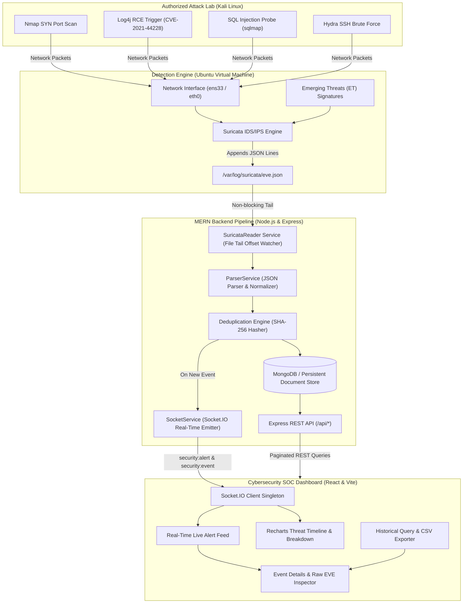

# Suricata SOC Monitor: Architecture & Data Flow

## 1. High-Level Architecture Overview

Suricata SOC Monitor is a full-stack, real-time Intrusion Detection and Prevention System (IDS/IPS) dashboard designed to ingest and visualize network security events generated by the Suricata engine running on an Ubuntu VM.

## 2. Ingestion Pipeline Mechanics

1. **Non-blocking Continuous File Tail**:
   - `SuricataReader` tracks the byte offset of `SURICATA_EVE_PATH`.
   - Instead of reading the entire file into memory, it uses `fs.openSync` and `fs.readSync` to stream only newly appended byte blocks.
   - Handles partial lines through an internal string buffer.

2. **Log Rotation Resilience**:
   - Monitors the file's inode and byte size using `fs.statSync`.
   - If the file size shrinks or the inode changes (indicating `logrotate` has swapped the active log), the reader automatically resets its byte position to 0 and reopens the fresh file without missing subsequent lines.

3. **Event Normalization & IDS vs IPS Action Semantics**:
   - `ParserService` safely parses each line, preserving original timestamps while handling missing/nullable fields (e.g., non-IP events or unclassified alerts).
   - Accurately distinguishes passive signature alerts (`ALERT`) from active inline packet drops (`DROP` / `REJECT`).
   - Generates a stable SHA-256 deduplication key to eliminate duplicate inserts if events are re-read across service restarts.

4. **Real-Time WebSocket Broadcast**:
   - `SocketService` emits `security:alert` for alert records and `security:event` for general telemetry.
   - Throttles aggregate statistics recalculation via `security:stats_tick` every 3 seconds to avoid UI thrashing under high packet rates.
